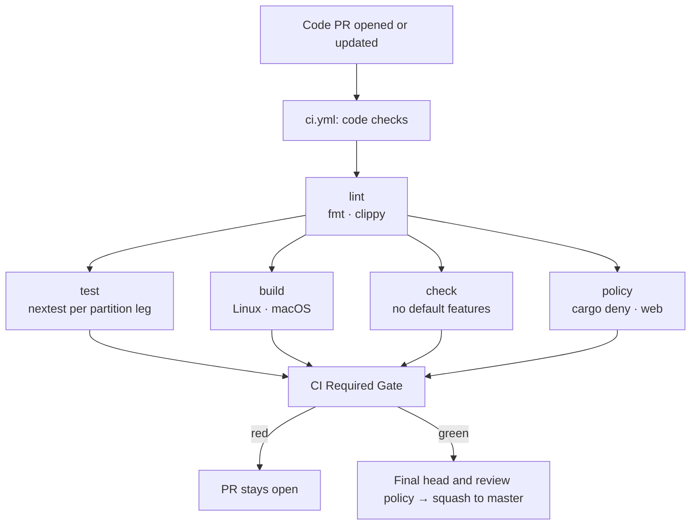

# Master Branch Delivery Flows

How code moves from a PR to `master`. ReiClaw publishes no releases; the owner installs from source with `./install.sh --source`.

Use with:

- [`docs/book/src/maintainers/ci-and-actions.md`](../../docs/book/src/maintainers/ci-and-actions.md)

Last reviewed: **November 2026** for `kckylechen1/zeroclaw`. This page describes fork policy and workflow behavior; verify live GitHub settings separately. The retained `merge_group` trigger is not evidence that this user-owned repository can enable a merge queue.

---

## Branching Model

ZeroClaw uses one default branch, `master`, with no permanent `dev` or promotion branch. Independent PRs target `master`. A dependent PR can temporarily target its parent branch; after the parent squash, replay only the child increment, retarget to current `master`, and inspect/validate the final result (AGENTS.md rule 9).

This fork is maintained by `kckylechen1`; review routing is in [CODEOWNERS](../CODEOWNERS). Actual GitHub permissions and review requirements determine who can merge. Upstream maintainers are not automatic reviewers or milestone owners for this fork.

---

## Active Workflows

| File | Trigger | Purpose |
|---|---|---|
| `ci.yml` | `pull_request` → any base; `push` → `master`; `merge_group` (reserved) | Scope classification, docs validation, selected Rust/build checks, and the aggregate result; trusted code pushes also warm Rust caches. The reserved trigger does not enable a queue. |
| `cross-platform-clippy.yml` | `pull_request` when runtime, infra, or this workflow changes; `workflow_dispatch`; weekly schedule | Advisory full-workspace macOS Clippy, including test targets; outside the required PR gate |

---

## Event Summary

| Event | What runs |
|---|---|
| PR opened or updated against `master` or a temporary parent branch | `ci.yml`; applicable docs/code checks and aggregate policy are described below. Runtime, infra, or cross-platform workflow changes also trigger `cross-platform-clippy.yml`. |
| `merge_group` | Reserved CI compatibility only. GitHub's merge-queue eligibility does not currently include this user-owned repository. |
| Push to `master` | `ci.yml` (scope-selected checks and docs style; code changes also warm trusted Rust caches; repository structure steps remain PR-only) |
| Manual dispatch | `cross-platform-clippy.yml` |

ReiClaw has no release pipeline. `ci.yml` runs after trusted `master` pushes
so post-merge Quality Gate runs can seed Rust caches for later PRs.

---

## Step-by-Step

### 1) PR → `master`

1. Contributor opens or updates a PR with an explicit scope and dependency, if any. The final landing target is `master`.
2. Use `scripts/ci/change_scope.py` as the canonical diff classifier and `scripts/ci/required_gate.py` as the expected-result policy, wired by `ci.yml`. Ordinary README/book prose receives the Markdown, source/navigation, and local-link checks. Code, workflow, policy, build, configuration, executable, and unknown paths retain full coverage; missing or uncertain diff evidence does too. Navigation, renderer, generator, and preprocessor-input changes also run the real docs build. The aggregate always reports and rejects failed, cancelled, or unexpected missing/skipped work.
3. The code path includes:
   - `changes` (Change Scope and Format): classifies the diff, selects the targeted jobs below, and runs `cargo fmt --all -- --check` and `scripts/ci/source_tree_gate.py` (orphaned sources, module-wide dead-code silencing, the approved crate list). Every other job waits on it. The hosted runners allow 20 concurrent jobs per account, so light checks share jobs rather than each taking a runner.
   - `lint`: `cargo clippy --workspace --all-targets --locked --features
     ci-all -- -D warnings`, plus the provider dispatch gate. This is the only
     all-features compile in the gate (benches included).
   - `build`: matrix across `x86_64-unknown-linux-gnu` and
     `aarch64-apple-darwin`. Windows is not a supported platform.
   - `check`: two jobs, each checking two graphs back to back: no default features plus the 32-bit target, and slim control plus the minimal companion feature set.
   - `test`: `cargo nextest run --locked` per phase of
     `dev/ci/test-partition.json`, one parallel job each: the main run of
     every leg (runtime, channels, app, eval, tail) plus each filtered extra
     run (`runtime / landlock`, `channels / voice-surface`). The matrix comes
     from `scripts/dev/leg.sh --matrix`; the app leg runs the architecture
     guards.
   - `policy` (Policy and Web): `cargo deny check`, lockfile integrity, `cargo audit`, the web permission and regression tests, and, on PRs only, the repository structure guard. Every step runs even when an earlier one fails.
   - `installer-drift`: `cargo generate installers --check` (PRs: only when
     manifests, `xtask/`, or generated install surfaces change; `changes`
     selects it).
   - `CI Required Gate`: stable aggregate for the classified result. Verify the actual required contexts rather than assuming cloud protection already uses this single job.
4. Review the final diff/head and check actual required CI and review policy. Carry out an already-authorized merge task without another yes/no exchange, keep monitoring pending checks, and squash with a final-head precondition. Verify GitHub's resulting state and merge SHA.

GitHub currently offers [merge queues](https://docs.github.com/en/repositories/configuring-branches-and-merges-in-your-repository/configuring-pull-request-merges/managing-a-merge-queue) for eligible organization-owned repositories. This fork's owner is a user, so queue enablement is not a one-click recovery option. The retained `merge_group` trigger can be useful if eligibility and configuration change later, but those facts and exact-result checks would need verification first. Do not confuse ordinary auto-merge with a merge queue or silently change repository ownership to obtain the feature.

---

## Diagrams

### Code PR to master

## Troubleshooting

1. **Gate red on PR**: check the `lint` job first (fmt/clippy failures are
   the most common cause), then `test`, then `build`.
